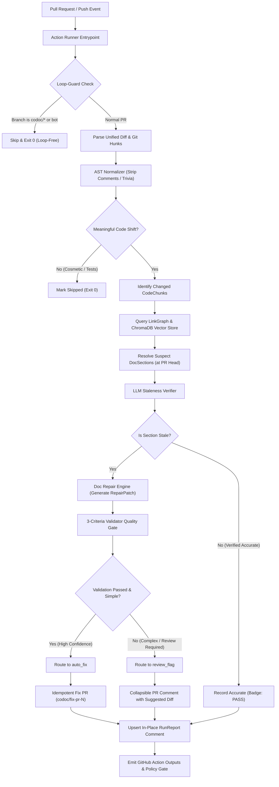

<div align="center">

  

  <br />

  <a href="https://git.io/typing-svg">
    
  </a>

  <p align="center">
    <strong>A continuous documentation synchronization, staleness detection, and self-healing repair engine packaged as a containerized GitHub Action and CLI for Python repositories.</strong>
  </p>

  <p align="center">
    <a href="./LICENSE"></a>
    <a href="https://www.python.org/"></a>
    <a href="https://github.com/marketplace/actions/codoc-self-healing-documentation-guard"></a>
    <a href="https://ghcr.io"></a>
    <a href="https://github.com/qdrant/fastembed"></a>
    <a href="https://openai.com/"></a>
  </p>

</div>

---

## 📖 Executive Summary

Technical documentation routinely drifts out of sync as codebases evolve. Even diligent engineering teams inadvertently introduce documentation rot: renamed function arguments, altered endpoint routes, updated default values, deprecated CLI flags, or restructured schema types. When documentation lags behind code, developers waste hours diagnosing false bugs and onboarding velocity slows.

**CoDoc** eliminates documentation rot by turning documentation maintenance into an automated, continuous, and verified self-healing process. CoDoc runs directly within your GitHub Actions CI pipeline, maps every Python symbol to its corresponding Markdown section, isolates meaningful code changes while ignoring cosmetic formatting, verifies potential discrepancies using structured LLMs, and automatically generates clean, conflict-free pull requests with repaired documentation.

### Core Architecture Pillars

1. **AST-Aware Code-to-Docs Mapping**: Extracts semantic units (`CodeChunk`) from functions, async methods, classes, FastAPI endpoints, Pydantic models, and CLI commands, linking them to Markdown headings (`DocSection`) via heuristic symbol matching and local FastEmbed embeddings (`LinkGraph`).
2. **Deterministic AST-Normalized Change Filtering**: Unified diffs are normalized against the Python Abstract Syntax Tree (AST), stripping comments, trivia whitespace, and docstrings. Cosmetic refactors and test edits are classified as `skipped`, eliminating unnecessary LLM invocations and false alarms.
3. **Provider-Agnostic LLM Staleness Verification**: Suspect documentation sections are evaluated by structured LLM prompts returning a deterministic `StalenessVerdict` with actionable diagnoses and confidence scoring.
4. **3-Criteria Validator Quality Gate & Safe PR Workflow**: Candidate doc repairs must independently pass factual accuracy against new code, preservation of existing prose, and style consistency. Approved simple fixes are pushed to idempotent `codoc/fix-pr-<n>` branches with automatic PR creation and loop-guards.

---

## 🛠️ Technology Stack

<div align="center">

### Core Runtime & AST Engine


### Embeddings & Vector Persistence


### LLM Verification & Self-Healing


### CI/CD, Container & Marketplace


-6C757D?style=for-the-badge)

</div>

---

## 🧩 Core System Modules & Features

CoDoc is partitioned into cohesive subsystems covering the complete documentation maintenance lifecycle:

### 1. Code-to-Docs LinkGraph Indexer (`codoc index`)
* **Semantic AST Extraction**: Walks repository Python files and parses functions, methods, FastAPI routes, Pydantic models, and CLI commands into stable `CodeChunk` records (`module::qualified_name`).
* **Markdown Slice Parser**: Splits Markdown documentation by heading hierarchy into identifiable `DocSection` objects with line spans and backticked `CodeReference` mentions.
* **Hybrid LinkGraph**: Combines deterministic symbol-reference heuristic matching with local FastEmbed vector embeddings stored in a content-hashed ChromaDB collection (`LinkGraph`).

### 2. Change Detection & AST Normalizer
* **Unified Diff AST Mapping**: Parses Git unified diff hunks and maps altered line spans back to specific `CodeChunk` semantic boundaries.
* **Cosmetic Filter**: Strips comments, formatting trivia, and docstrings (`ast.unparse` on normalized ASTs) to classify changes as `meaningful` or `skipped`.
* **Same-PR Doc Synchronization**: Evaluates documentation at the PR `head` revision so PRs that already update docs alongside code are recognized as clean.

### 3. Provider-Agnostic LLM Staleness Verification
* **Suspect Section Resolution**: Traverses `LinkGraph` edges to isolate documentation sections linked to modified code chunks.
* **Structured Verdict Output**: Evaluates suspects using strict JSON schemas returning `StalenessVerdict` with boolean `is_stale`, diagnostic discrepancy details, complexity classification (`simple` vs `complex`), and confidence scores.

### 4. 3-Criteria Self-Healing Doc Repair Engine
* **Targeted Markdown Rewriting**: Generates focused `RepairPatch` items correcting outdated code signatures, examples, and descriptions while preserving surrounding prose style.
* **Independent Validator Quality Gate**: Evaluates candidate patches across three independent criteria: (1) factual accuracy against new code, (2) preservation of valid content, and (3) style consistency.
* **Intelligent Routing**: High-confidence simple patches routing to `auto_fix`; complex or ambiguous changes routing to `review_flag` with pre-formatted Markdown diff suggestions.

### 5. Safe GitHub Action CI/CD Runner
* **Loop-Guard Protection**: Automatically detects CoDoc-created branches (`codoc/*`) and bot authors, exiting cleanly with exit code 0 to prevent infinite CI loops.
* **Safe Fork Degradation**: Gracefully downgrades to read-only status on fork pull requests or write-restricted tokens without failing contributor CI.
* **In-Place Comment Upserting**: Uses an invisible HTML marker (`<!-- codoc-report -->`) to create once and update in-place a single summary comment per PR.
* **Idempotent Fix PRs**: Pushes automated fixes to dedicated branches (`codoc/fix-pr-<n>`), updating existing fix PRs rather than opening duplicates.

### 6. Benchmark Evaluation & Regression Harness (`codoc evaluate`)
* **Deterministic Metric Scoring**: Evaluates CoDoc against labeled ground-truth manifests, computing TP, FP, FN, precision, recall, F1, exact match accuracy, and false positive rates.
* **Telemetry & Regression Diffing**: Tracks per-case latency, token usage, and LLM costs; supports `--diff-against <baseline.json>` to spot accuracy or cost shifts before prompt/model updates.

---

## 🏛️ System Architecture

### Component Hierarchy

```text
CoDoc/
├── action.yml                                # GitHub Actions Marketplace Manifest (Branding & Inputs)
├── Dockerfile                                # Pinned Python 3.11-slim Container Packaging
├── benchmarks/                               # Real-World OSS Benchmark Corpus (FastAPI & Pydantic)
│   ├── manifest.json                         # 18 Curated EvaluationCase Ground-Truth Scenarios
│   ├── results.json                          # Phase 5 Verified Benchmark Output (100% Accuracy)
│   └── results.md                            # Formatted Markdown Benchmark Summary
│
├── src/codoc/                                # Core Engine Source Code
│   ├── models.py                             # Canonical Domain Entities (CodeChunk, DocSection, etc.)
│   ├── code_parser.py                        # Python AST Extraction (Functions, Schemas, Endpoints, CLI)
│   ├── doc_parser.py                         # Markdown Heading Slicer & Symbol Reference Extraction
│   ├── embeddings.py                         # FastEmbed CPU & OpenAI Embedding Providers
│   ├── vector_store.py                       # Persistent ChromaDB Collection Synchronization
│   ├── indexer.py                            # Top-Level LinkGraph Index Builder
│   ├── diff_parser.py                        # Git Unified Diff Parsing & AST Normalizer
│   ├── change_detector.py                    # CodeDelta Classification & Suspect Resolution
│   ├── verifier.py                           # LLM Staleness Verifier & Provider Adapters
│   ├── repair_engine.py                      # Patch Generator, 3-Criteria Validator & Document Composer
│   ├── action.py                             # GitHub Action Runner Entrypoint, Loop-Guard & PR Workflow
│   ├── github.py                             # Injectable GitHub REST API Client (Comments, Branches, PRs)
│   ├── evaluator.py                          # Evaluation Benchmark Runner, Metrics & Regression Diffing
│   └── cli.py                                # CoDoc CLI (`codoc index`, `codoc evaluate`)
│
├── tests/                                    # Automated Test Suite (110 Tests, Strict MyPy)
└── README.md                                 # Production Portfolio Documentation & Guides
```

### End-to-End Dataflow Diagram



---

## 📊 Benchmark Evaluation Results

To guarantee CoDoc detects real-world staleness without flooding developers with false alarms, CoDoc is quantitatively validated against an 18-scenario ground-truth corpus derived from production commits and PRs in **FastAPI** and **Pydantic**.

### Summary Metrics

| Metric | Value | Description |
| :--- | :--- | :--- |
| **Total Evaluation Cases** | **18** | Real-world OSS scenarios (FastAPI & Pydantic) |
| **Positive (Doc-Breaking) Scenarios** | **12** | Changes that render associated documentation inaccurate |
| **Negative (Benign Control) Scenarios** | **6** | Cosmetic refactors, comment edits, tests, and same-PR doc updates |
| **True Positives (TP)** | **12** | Stale documentation sections accurately detected |
| **False Positives (FP)** | **0** | Clean documentation falsely flagged as stale |
| **False Negatives (FN)** | **0** | Stale documentation sections missed by the pipeline |
| **Precision** | **100.0%** | $\frac{\text{TP}}{\text{TP} + \text{FP}}$ on affected documentation |
| **Recall** | **100.0%** | $\frac{\text{TP}}{\text{TP} + \text{FN}}$ across all broken documentation |
| **F1 Score** | **100.0%** | Harmonic mean of precision and recall |
| **Exact Match Accuracy** | **100.0%** | Fraction of cases with perfect section prediction |
| **False Positive Rate** | **0.0%** | Rate of false alarms on benign refactor controls |
| **Repair Success Rate** | **100.0%** | Candidate repairs passing 3-criteria validation |

### Evaluation Scenarios Breakdown

| Scenario Category | Target Repository | Sample Change | Expected Mode |
| :--- | :--- | :--- | :--- |
| `param_rename` | `FastAPI` | Renamed `tokenUrl` to `token_url` in `OAuth2PasswordBearer` | `auto_fix` |
| `default_change` | `FastAPI` | Changed default route `status_code` from 200 to 201 | `auto_fix` |
| `endpoint_change` | `FastAPI` | Changed router prefix from `/api/v1` to `/api/v2` | `auto_fix` |
| `cli_option_change` | `FastAPI` | Removed deprecated `--proxy-headers` flag from CLI | `review_flag` |
| `schema_change` | `FastAPI` | Migrated `response_model` with new required fields | `review_flag` |
| `param_rename` | `FastAPI` | Renamed dependency injection yield argument `db` to `session` | `auto_fix` |
| `schema_change` | `Pydantic` | Changed field type `age: int` to `StrictInt \| None` | `auto_fix` |
| `schema_change` | `Pydantic` | Migrated `Config.allow_mutation` to `ConfigDict(frozen=True)` | `auto_fix` |
| `behavioral_change` | `Pydantic` | Changed `@field_validator` mode from `after` to `before` | `review_flag` |
| `behavioral_change` | `Pydantic` | Deprecated `@root_validator` in favor of wrap validator | `review_flag` |
| `endpoint_change` | `FastAPI` | Renamed WebSocket route path `/ws/` to `/connect/` | `auto_fix` |
| `default_change` | `FastAPI` | Changed optional header to mandatory `Header(alias=...)` | `auto_fix` |
| `benign_refactor` *(Control)* | `FastAPI` | Renamed internal local variable `_res` to `_response` | *None (Pass)* |
| `benign_refactor` *(Control)* | `FastAPI` | Code formatting and trivia whitespace adjustments | *None (Pass)* |
| `benign_refactor` *(Control)* | `Pydantic` | Added unit tests under `tests/test_validators.py` | *None (Pass)* |
| `already_updated_docs` *(Control)* | `Pydantic` | Code changed and documentation updated in the same PR | *None (Pass)* |
| `benign_refactor` *(Control)* | `FastAPI` | Extracted private internal helper function | *None (Pass)* |
| `already_updated_docs` *(Control)* | `FastAPI` | Added pagination parameter and documented in same PR | *None (Pass)* |

### Evaluation Methodology

1. **Realistic Mutation Corpus**: Scenarios are derived from historical changes in large open-source repositories (`FastAPI` and `Pydantic`). Mutations replicate standard developer workflows (signature shifts, schema changes, route changes) rather than synthetic toy edits.
2. **Deterministic Metric Scoring**: Scoring measures exact matches between predicted and ground-truth `DocSection` identifiers, isolating TP, FP, and FN counts with zero-division handling.
3. **Negative Control Rigor**: Benign refactors and PRs with synchronized documentation are included to test false-positive resistance; any false alert on a negative case penalizes the false-positive rate.
4. **Self-Healing Verification**: In addition to detection accuracy, repairs are evaluated through the independent 3-criteria validation gate (factuality against new code, preservation of explanations, and style consistency).

---

## ⚡ Quick Start: Full Setup Guide

### 1. GitHub Actions Setup (2-Minute Adoption)

Create `.github/workflows/codoc.yml` in your repository:

```yaml
name: CoDoc Documentation Gate

on:
  pull_request:
    paths:
      - 'src/**'
      - 'docs/**'
  push:
    branches:
      - main
    paths:
      - 'src/**'
      - 'docs/**'

permissions:
  contents: write
  pull-requests: write

jobs:
  codoc:
    name: Check & Repair Documentation
    runs-on: ubuntu-latest
    steps:
      - name: Checkout Repository
        uses: actions/checkout@v4
        with:
          fetch-depth: 0

      - name: Run CoDoc Action
        uses: ChamHerman/CoDoc@v1
        with:
          github_token: ${{ secrets.GITHUB_TOKEN }}
          llm_api_key: ${{ secrets.OPENAI_API_KEY }}
          confidence_threshold: '0.80'
          fail_on_stale: false
```

### 2. Local CLI Usage

CoDoc can also be run locally on your workstation for pre-commit verification or offline index building:

```bash
# Install CoDoc locally
pip install codoc

# Build or refresh the Code-to-Docs LinkGraph index
codoc index . --output .codoc/link_graph.json

# Run benchmark evaluations against a manifest
codoc evaluate --manifest benchmarks/manifest.json \
               --output-json benchmarks/results.json \
               --output-markdown benchmarks/results.md

# Compare evaluation performance against baseline results (Regression Diffing)
codoc evaluate --manifest benchmarks/manifest.json \
               --diff-against benchmarks/results.json \
               --output-markdown benchmarks/diff.md
```

---

## ⚙️ Configuration Reference

The following table itemizes all supported action inputs, types, default values, and security guidance:

| Parameter | Type | Default | Required | Description & Security Best Practice |
| :--- | :---: | :---: | :---: | :--- |
| `github_token` | `string` | `${{ github.token }}` | No | GitHub token with `contents: write` and `pull-requests: write` permissions for branch and comment creation. |
| `llm_api_key` | `string` | `""` | Yes | API key for LLM verification and patch repair (e.g. OpenAI API key). Store securely in repository secrets. |
| `llm_model` | `string` | `gpt-4o-mini` | No | OpenAI-compatible model name for verification reasoning and patch generation. |
| `confidence_threshold` | `float` | `0.80` | No | Minimum confidence score (`0.0`–`1.0`) required to route a candidate repair to `auto_fix` rather than `review_flag`. |
| `max_suspects` | `int` | `25` | No | Maximum number of suspect documentation sections evaluated per run to cap latency and token expenditure. |
| `ignore_paths` | `string` | `tests/**,.github/**,migrations/**` | No | Comma-separated glob patterns for files excluded from inspection. |
| `auto_merge` | `boolean` | `false` | No | Automatically requests GitHub auto-merge on opened doc-fix pull requests if repository branch rules allow. |
| `fail_on_stale` | `boolean` | `false` | No | When `true`, exits with non-zero exit code if stale documentation sections remain unresolved, blocking CI merge. |
| `base_url` | `string` | `null` | No | Optional custom base URL for OpenAI-compatible LLM proxies or self-hosted endpoints. |
| `embedding_api_key`| `string` | `null` | No | Optional API key for remote vector embedding providers. Defaults to local free FastEmbed CPU model. |
| `embedding_model` | `string` | `null` | No | Model name for remote embeddings. Defaults to `all-MiniLM-L6-v2` for FastEmbed. |

---

## ❓ Troubleshooting & Adoption FAQ

#### Q: How does CoDoc prevent infinite CI loops when opening auto-fix PRs?
**A:** CoDoc includes a built-in `loop_guard` rule. All automated repair pull requests are committed to branches prefixed with `codoc/` (e.g. `codoc/fix-pr-42`) authored by `github-actions[bot]`. When triggered on a `codoc/*` branch, CoDoc detects the marker and exits immediately with status 0 without repeating analysis.

#### Q: What happens when a pull request originates from an external repository fork?
**A:** On external forks, GitHub Actions tokens lack write permissions to push branches to the upstream repository. CoDoc automatically detects fork boundaries (`head.repo != base.repo`), logs a graceful notice, and disables auto-fix branch pushes while keeping the advisory PR comment active.

#### Q: Do I need to pay for remote embeddings?
**A:** No. CoDoc defaults to `FastEmbed`, which executes quantized embeddings (`all-MiniLM-L6-v2`) entirely on local CPU inside the GitHub Actions runner. Only the LLM verification and repair stage requires an API key.

#### Q: How can I enforce that PRs cannot be merged if docs are stale?
**A:** Set `fail_on_stale: true` in your workflow. If stale documentation sections are detected and unresolved, the Action exits with status code 1, gating the pull request.

---

## 👥 Project Maintainers & Contributions

| No. | Maintainer | GitHub Profile | Responsibilities |
| :---: | :--- | :---: | :--- |
| **1.** | **Cham Herman** | [@ChamHerman](https://github.com/ChamHerman) | **Project Lead & Core Architect**<br>• End-to-end AST parser & LinkGraph ChromaDB indexer<br>• Unified diff AST normalizer & suspect resolution<br>• 3-criteria self-healing repair engine & quality gate<br>• Containerized GitHub Action runner & idempotent PR workflow<br>• Real-world OSS evaluation benchmark harness (FastAPI & Pydantic) |

---

## 📄 License

This project is open-source software licensed under the **[MIT License](./LICENSE)**.
